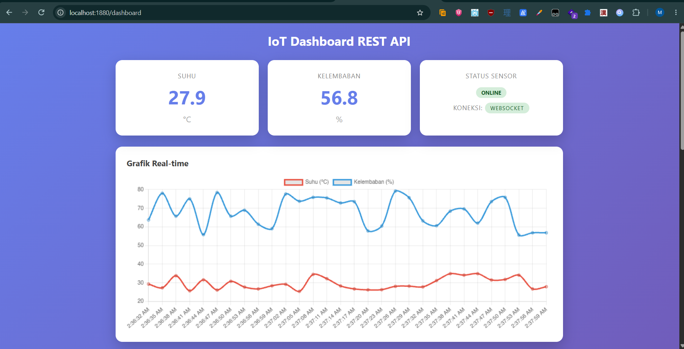
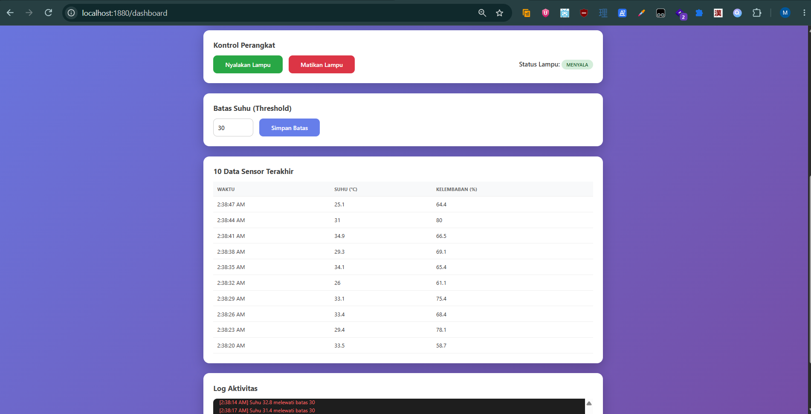
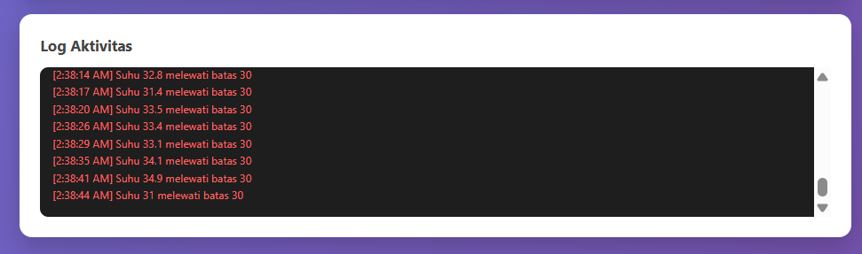

# Sistem Monitoring & Kontrol IoT Berbasis REST API Node-RED

Repository ini berisi hasil pengerjaan **Tugas Praktek 9: REST API Node-RED untuk Sistem IoT** pada mata kuliah **Pemrograman Internet of Things (SIF1502)**, Program Studi S1 Sistem Informasi, Universitas Islam Kalimantan Muhammad Arsyad Al-Banjari.

## Identitas Mahasiswa
* **Nama:** M. Hafizh Sparta
* **NPM:** 2410020118
* **Mata Kuliah:** Pemrograman Internet of Things (SIF1502)

---

## Arsitektur Sistem

Sistem ini memisahkan lapisan perangkat keras/simulator, *backend* API, dan antarmuka pengguna (*frontend*) dengan alur komunikasi sebagai berikut:

1. **Publisher / Simulator (`simulasi_esp32.py`):** Mensimulasikan mikrokontroler ESP32 dan sensor DHT11/DHT22 yang mengirimkan data suhu dan kelembapan setiap 3 detik ke **Mosquitto MQTT Broker** (`localhost:1883`) pada topik `iot/sensor`, serta menerima perintah kontrol (`iot/kontrol`) dan peringatan suhu (`iot/notifikasi`).
2. **Backend REST API & Broker Integration (`flows.json`):** Node-RED berperan sebagai *middleware* yang berlangganan (*subscribe*) data sensor dari MQTT, menyimpannya ke database lokal, menyiarkannya via WebSocket, dan menyediakan *endpoint* REST API.
3. **Custom Web Dashboard (`dashboard.html`):** Antarmuka web mandiri berbasis HTML, CSS, dan JavaScript yang disajikan melalui Node-RED (`http://localhost:1880/dashboard`) untuk pemantauan grafik, riwayat data, pengaturan batas suhu, dan kontrol perangkat jarak jauh.

---

## Fitur yang Diimplementasikan

Selain fungsionalitas dasar praktikum, proyek ini juga mencakup seluruh **5 fitur pengembangan (nilai tambah)**:

1. **Endpoint Threshold & Notifikasi Otomatis (`/api/threshold`):** Mendukung metode `GET` dan `PUT` untuk mengubah batas maksimal suhu secara dinamis serta mengirim peringatan otomatis ke topik MQTT `iot/notifikasi` apabila suhu melebihi batas.
2. **Grafik Real-time (`Chart.js`):** Visualisasi fluktuasi suhu ($^\circ\text{C}$) dan kelembapan ($\%$) secara langsung pada halaman *dashboard*.
3. **Autentikasi API Key (`X-API-Key`):** Setiap permintaan ke *endpoint* `/api/*` divalidasi menggunakan *header* `X-API-Key` untuk mencegah akses tidak sah.
4. **Komunikasi Real-time dengan WebSocket (`/ws/sensor`):** Pembaruan kartu sensor, grafik, dan tabel riwayat dilakukan secara instan melalui jalur WebSocket dengan mekanisme *fallback polling* otomatis jika koneksi terputus.
5. **Penyimpanan Riwayat ke Database (`SQLite`):** Seluruh data sensor yang masuk disimpan secara persisten ke dalam file basis data `iot.db`.

---

## Daftar Endpoint REST API

Semua *endpoint* API memerlukan *header* autentikasi `X-API-Key: iot-kampus-123`.

| Method | Endpoint | Fungsi |
| :--- | :--- | :--- |
| `GET` | `/dashboard` | Menyajikan halaman antarmuka `dashboard.html` |
| `GET` | `/api/suhu` | Mengambil data pembacaan sensor terbaru |
| `GET` | `/api/history` | Mengambil 50 riwayat data sensor terakhir dari database SQLite |
| `POST` | `/api/kontrol` | Mengirim perintah kontrol perangkat (`device` & `action`) ke topik MQTT `iot/kontrol` |
| `GET` | `/api/threshold` | Mengambil nilai batas suhu (*threshold*) yang sedang aktif |
| `PUT` | `/api/threshold` | Memperbarui nilai batas suhu maksimal |

---

## Struktur File Repository

```text
├── simulasi_esp32.py      # Script Python simulator sensor ESP32 (MQTT Publisher & Subscriber)
├── flows.json             # Konfigurasi flow Node-RED (REST API, WebSocket, SQLite, MQTT)
├── dashboard.html         # Halaman web dashboard kustom (HTML/CSS/JS + Chart.js)
├── screenshots/           # Dokumentasi hasil uji coba sistem
│   ├── dashboard-1.png    # Tampilan kartu sensor, status WebSocket, dan grafik Chart.js
│   ├── dashboard-2.png    # Tampilan kontrol lampu, threshold suhu, dan tabel riwayat SQLite
│   └── dashboard-3.png    # Tampilan log aktivitas dan notifikasi batas suhu
└── README.md              # Dokumentasi proyek
```

---

## Cara Menjalankan Sistem

### 1. Prasyarat
* **Mosquitto MQTT Broker** berjalan di `localhost:1883`
* **Node.js** dan **Node-RED** terinstal beserta paket `node-red-node-sqlite`
* **Python 3** dengan pustaka `paho-mqtt` (`pip install paho-mqtt`)

### 2. Langkah Menjalankan
1. Jalankan layanan **Mosquitto** di latar belakang.
2. Buka terminal dan jalankan server **Node-RED**:
   ```bash
   node-red
   ```
3. Buka editor Node-RED di `http://localhost:1880`, lakukan **Import** file `flows.json`, pastikan jalur file `dashboard.html` pada *node* **Baca dashboard.html** sudah sesuai dengan lokasi folder lokal, lalu klik **Deploy**.
4. Buka terminal baru pada direktori proyek dan jalankan simulator ESP32:
   ```bash
   python simulasi_esp32.py
   ```
5. Buka peramban dan akses halaman *dashboard* melalui alamat:
   ```text
   http://localhost:1880/dashboard
   ```

---

## Dokumentasi Hasil Uji Coba

### 1. Monitoring Real-time (WebSocket & Chart.js)


### 2. Kontrol Perangkat, Threshold Suhu, dan Riwayat SQLite


### 3. Log Aktivitas dan Peringatan Batas Suhu

